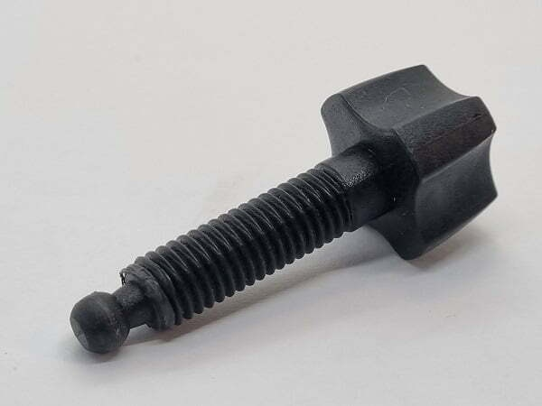
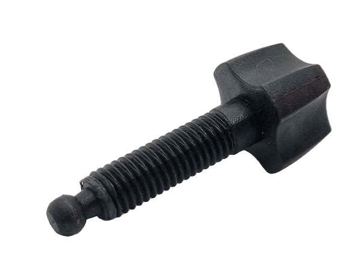

# 2dTo3d

Turns a single 2D photo into a 3D-printable STL model: AI background removal, a pseudo-depth map estimated from the remaining image, then a triangle mesh extruded from that depth map.

| Input | Background removed | Depth map → mesh |
|---|---|---|
|  |  | [sample_output.stl](sample_output.stl) |

## How it works

1. **Background removal** — either AI-based (via [`rembg`](https://github.com/danielgatis/rembg)) or a traditional OpenCV watershed segmentation, producing a clean foreground mask.
2. **Depth estimation** — since there's no real depth sensor, depth is *approximated* from the 2D image using one of three heuristics:
   - `gradient` (default) — blends local intensity with inverse gradient magnitude, so flatter/brighter regions sit higher and edges sit lower.
   - `edge` — distance transform from Canny edges.
   - `intensity` — raw pixel brightness as height.
3. **Mesh generation** — the depth map is extruded into a top surface, given a flat base, and stitched with side walls into a closed, printable solid.
4. **STL export** — written with `numpy-stl`.

This is a heightmap approximation, not real 3D reconstruction — it works best on objects with a reasonably flat profile and decent lighting contrast (the `sample_*` files are a photographed bolt).

## Usage

Interactive:

```bash
pip install -r requirements.txt
python image_to_stl.py
```

Programmatic:

```python
from image_to_stl import ImageTo3D

converter = ImageTo3D(max_height=15.0, base_thickness=3.0)
converter.process_image_to_stl(
    image_path="sample_bg_removed.png",
    output_path="sample_output.stl",
    method="gradient",
    resolution_factor=0.3,
    remove_bg=True,
)
```

See `simple_example.py` for a minimal script.

### Parameters

- `max_height` / `base_thickness` — vertical scale of the relief and thickness of the flat base, in whatever units your slicer uses.
- `resolution_factor` — downsamples the image before meshing; mesh size grows with the square of resolution, so start low (0.3–0.5) and increase only if you need more detail.
- `remove_bg` — strip the background before estimating depth so it doesn't get meshed along with the subject.
